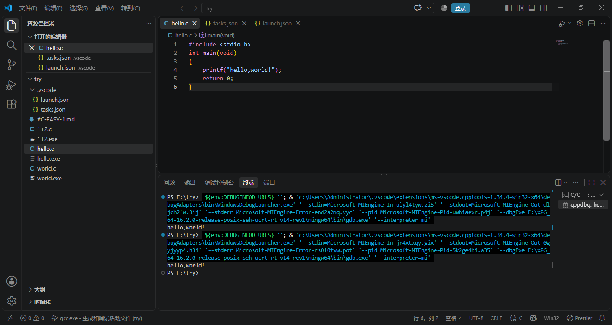
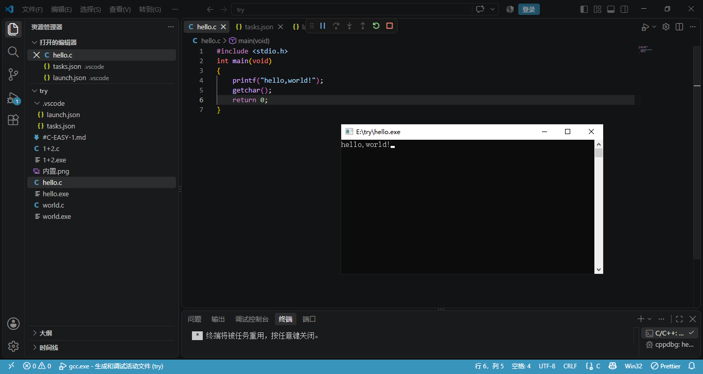

# C-EASY-1

## part 1

### 1 什么是GCC？什么是MinGW？它的作用是什么？

1）、GCC全称是GNU Compiler Collectino，是一个开源编辑器。本质上是一个软件，但并不是一个图形界面的软件（如QQ，微信）而是一个命令行程序，可以把C代码变成可执行的文件。核心作用即把源代码翻译成可执行的程序

2）、MinGW全称是Minimalist GNU for Windows，是一个工具集GCC最早开发、运行在Linux（与Windows同一层级的一个操作系统）上，Windows上本来没有GCC，所以要靠MinGW把它搬过来，让我可以在Windows环境中使用GCC来编译出Windows可执行文件(.exe)

3）、作用上来看GCC是编译器本身，而MinGW是让GCC可以在Windows上工作的那套工具链

### 2 c_cpp_properties.json， launch.json ，tasks.json这三个文件分别有什么作用？
这三个文件分别负责C/C++开发流程中不同环节的配置。  
1）、tasks.json是编译配置。负责编译，相当于把在终端输入的编译命令封装成一个可复用的任务（生成.exe文件），关键配置包括调用哪个编译器、传递什么参数，一直输出文件位置快捷键（`Ctrl+Shift+B`）即可触发。

2）、c_cpp_properties.json是智能感知配置。控制编辑器的智能提示（eg：代码补全、语法高亮、错误检查、头文件搜索路径）比如编辑时的字体颜色，智能联想提示等。该文件不影响实际的编译过程，只服务于编辑体验。

3）、launch.json是调试配置，它决定如何运行和调试程序：指定调试器（如GDB）的路径（让VScode找到调试器的位置）、指定要调试的可执行文件等。同时该文件一般还会关联tasks.json中的任务，在调试之前自动重新编译，快捷键（`F5`）会让VScode读取此文件来启动对话

### 3 为什么要在编辑器内下载C语言的插件，插件的作用又是什么？
1）、代码编辑器本身并不具备C/C++语言的原生支持能力，也不包含编译器或调试器，安装C/C++扩展之后代码编辑器（VSCode）才具备智能感知、代码导航、调试支持等能力，插件本身并不包含编译器，只是座桥梁，让VSCode知道如何使用安装好的编译器，并在编辑器层面提供开发体验支持。

2）、补全 launch.json 注释
以下是我补全注释后的 launch.json 文件，并将 miDebuggerPath 修改为自己电脑上的实际路径（E:\x86_64-16.2.0-release-posix-seh-ucrt-rt_v14-rev1\mingw64\bin\gdb.exe）

``` {
    // 使用 IntelliSense 了解相关属性。
    // 悬停以查看现有属性的描述。
    // 欲了解更多信息，请访问: https://go.microsoft.com/fwlink/?linkid=830387
    "version": "0.2.0", // 调试配置文件版本号，固定为 0.2.0
    "configurations": [
        {
            "name": "gcc.exe - 生成和调试活动文件", // 配置名称，显示在调试下拉菜单中
            "type": "cppdbg", // 调试器类型，cppdbg 表示使用 C/C++ 扩展的调试器
            "request": "launch", // 请求类型，launch 表示启动新程序进行调试
            "program": "${fileDirname}\\${fileBasenameNoExtension}.exe", // 要调试的可执行文件路径：当前文件所在目录下的同名 .exe
            "args": [], // 传递给程序的命令行参数，这里为空
            "stopAtEntry": false, // 是否在程序入口处（main 函数）暂停，false 表示直接运行
            "cwd": "${workspaceFolder}", // 程序运行的工作目录，这里为工作区根目录
            "environment": [], // 传递给程序的环境变量，这里为空
            "externalConsole": false, // 是否使用外置终端：false 使用 VS Code 内置终端/调试控制台；true 弹出独立命令行窗口
            "MIMode": "gdb", // 调试模式，使用 GDB
            "miDebuggerPath": "E:\\x86_64-16.2.0-release-posix-seh-ucrt-rt_v14-rev1\\mingw64\\bin\\gdb.exe", // GDB 调试器的实际路径（注意使用双反斜杠）
            "setupCommands": [ // 调试器启动时的初始化命令
                {
                    "description": "为 gdb 启用整齐打印", // 描述
                    "text": "-enable-pretty-printing", // GDB 命令：让结构体等复杂数据输出更易读
                    "ignoreFailures": true // 如果命令执行失败是否忽略
                }
            ],
            "preLaunchTask": "C/C++: gcc.exe build active file" // 调试前预先执行的编译任务，对应 tasks.json 中的任务
        }
    ]
}
```
### 运行截图
内置

外置


## Part 2
### 1 变量类型
1）、变量的类型可以告诉编译器这个变量能存什么数据，占多少内存、如何解释这段内存，以及可以进行哪些操作。比如int（整数），float（浮点数），char（单个字符）。它的重要就在于他决定了变量所占的内存大小、取值范围和可以进行的操作，保证类型安全，同时提高了代码的可读性和可维护性。  
2）、存放年年龄18应该选择整数（int），因为年龄是整数且18在int的取值范围之内，语义清晰。如果用浮点数float显示年龄为18.0。浪费空间且可能存在精度问题。  
3）、char不可以存单词apple。char是字符类型通常只存放一个字符。正确的存储方式如**store.c**
### 2 数组的起始与边界
1）、数组的第一个元素下标通常从0开始。  
2）、对于C语言来说，下标超出有效范围可能会读到相邻变量、无关的垃圾数据、其他对象的数据，甚至敏感信息。甚至可能会使程序突然崩溃。  
3）、为什么常见：
* C 语言不进行数组边界检查：编译器只做地址计算，不验证下标是否合法，越界代码通常可以正常编译。
* 差一错误：长度为 n 的数组，合法下标是 0 ~ n-1，循环中误写成 i <= n 就会访问 arr[n]。

4）、为什么危险：
* 属于未定义行为：C 标准不保证越界后的结果，可能读到垃圾值、写坏数据、程序崩溃，也可能看起来正常。
* 静默破坏内存：越界写可能覆盖相邻变量、结构体、栈帧、函数返回地址、堆管理信息等。
### 3 流程控制 - 循环结构
1）、通过以下步骤：初始化，条件判断，执行循环体，更新状态，回到步骤2.  
2）、基本结构：
```c
for (初始化表达式; 循环条件; 更新表达式) {
    // 循环体（被重复执行的代码块）
}
```

```c
while (循环条件) {
    // 循环体（被重复执行的代码块）
}
```
3）、
* 初始化：通常是定义并赋值一个计数变量器，告诉计算机这个循环从生么状态开始。
* 条件判断：判断是否满足条件，决定循环是否继续。
* 迭代:每次循环结束之后进行，用于改变变量，确保循环不会停留在原地。最终走到条件不成立然后停下。

4）、while先判断后执行，do-while先执行一轮之后再进行判断。尝试用两种结构实现同一任务如**while1+10.c** ; **do-while1+10.c**
### 4 流程控制 - 逻辑表达式
1）、
* 运算对象：算术表达式运算对象是数值本身，运算过程是对数值的加工。逻辑表达式运算对象是“条件是否成立”，运算过程是“真假判断”的组合。
* 运算结果：算术表达的运算结果可以是任意数值--整数、小数、正数、负数...范围无限。而逻辑表达式的结果只有两个值--0或1：真（条件成立）结果是1，假（条件不成立）结果是0 。
2）、
* &&：逻辑与，同真才真。
* ||：逻辑或，一真则真。
* ！：逻辑非，真变假，假变真。
程序如  **Part2.c**
## Part 3
## 1
程序如 **paixu（2）.c**
## 2
自行添加printf（“交换之后a=%d，b=%d”，a，b）之后打印的结果并未交换，原因如下：

C 语言默认采用“值传递”机制。在调用 swap(a, b) 时，实参 a 和 b 的值（10 和 20）被复制给了形参 a 和 b。此时，形参 a、b 和实参 a、b 在内存中是两组完全不同的变量，占用不同的内存地址。在 swap 函数内部，虽然形参 a 和 b 的值成功发生了交换（形参 a 变为 20，形参 b 变为 10），但交换的仅仅是这份“拷贝”的值。当函数执行结束，形参 a、b 的内存被释放，实参 a、b 的值依然保持原样，没有受到任何影响。
修改后的程序如 **swap.c**